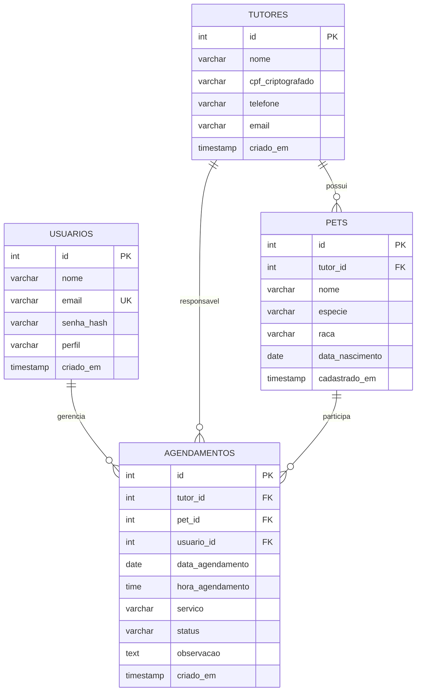

# Vet Bem Estar — Sistema de Gestão Veterinária

Documentação do sistema criado para a avaliação prática do SAEP.

## 1. Sobre o sistema

O Vet Bem Estar foi criado para ajudar uma clínica veterinária a controlar os tutores, os pets e os agendamentos. A ideia é substituir anotações manuais por um sistema simples, com login e proteção dos dados pessoais.

O sistema foi desenvolvido em PHP usando uma organização MVC. O banco de dados utilizado é o PostgreSQL e o acesso é feito com PDO.

## 2. Requisitos funcionais — Anexo 1

| ID | Requisito | Descrição |
|---|---|---|
| RF-01 | Login e sessão | O usuário entra com e-mail e senha. O sistema informa quando os dados estão incorretos e encerra a sessão depois de 15 minutos sem atividade. |
| RF-02 | Painel principal | Depois do login, o sistema mostra o nome do usuário e links para tutores, pets e agendamentos. Também existe a opção de sair. |
| RF-03 | Tutores | Permite cadastrar, listar, pesquisar, editar e excluir tutores. O CPF é criptografado antes de ser salvo no banco. |
| RF-04 | Pets | Permite cadastrar e listar pets. Cada pet precisa ser ligado a um tutor. |
| RF-05 | Agendamentos | Permite cadastrar e listar agendamentos por data, mostrando tutor e pet. Também permite alterar a data e a hora. |

## 3. Requisitos de infraestrutura

| Item | Informação |
|---|---|
| Linguagem | PHP 8.2 ou superior |
| Banco de dados | PostgreSQL |
| Banco utilizado | `vet_db` |
| Acesso ao banco | PDO com prepared statements |
| Dependências | Composer |
| Organização | MVC com autoload PSR-4 |

## 4. Segurança utilizada

- As senhas são salvas usando `password_hash` e conferidas com `password_verify`.
- O CPF é armazenado com criptografia AES-256-CBC.
- As consultas ao banco usam prepared statements.
- Os formulários usam token CSRF.
- Os dados exibidos nas páginas passam por escape para reduzir o risco de XSS.
- A sessão expira após 15 minutos sem atividade.

## 5. Diagrama entidade-relacionamento (DER)



## 6. Banco de dados

O arquivo [saep_db.sql](./saep_db.sql) cria as tabelas e insere pelo menos três registros em cada tabela, como foi pedido na prova.

Para criar e carregar o banco:

```sql
CREATE DATABASE vet_db;
```

Depois de entrar no banco `vet_db`, execute:

```bash
psql -U postgres -d vet_db -f saep_db.sql
```

Usuários fictícios para teste — todos usam a senha `123456`:

| Nome | E-mail | Perfil |
|---|---|---|
| Dra. Helena Martins | `helena.martins@vetbemestar.com` | Veterinário |
| Rafael Nogueira | `rafael.nogueira@vetbemestar.com` | Recepcionista |
| Juliana Freitas | `juliana.freitas@vetbemestar.com` | Administrador |

## 7. Como executar o sistema

Com o PostgreSQL ligado e o banco carregado, abra o PowerShell na pasta `sistema`:

```powershell
cd sistema
php -S localhost:8000 -t public
```

Depois acesse:

```text
http://localhost:8000/login
```

## 8. Testes dos requisitos funcionais

| Requisito | Procedimento de teste | Resultado esperado | Status |
|---|---|---|---|
| RF-01 — Login e sessão | Informar uma senha incorreta e depois acessar o sistema com dados válidos. Permanecer sem atividade por 15 minutos. | Exibir erro no login inválido, permitir o login válido e pedir novo login depois da expiração. | **Aprovado** |
| RF-02 — Painel principal | Entrar no sistema e acessar os links do painel. Depois clicar em sair. | Mostrar o nome do usuário, os acessos de tutores, pets e agendamentos e voltar ao login ao sair. | **Aprovado** |
| RF-03 — Tutores | Cadastrar um tutor, pesquisar pelo nome, editar seus dados e excluí-lo. | O registro deve aparecer na busca, aceitar a edição e ser removido após a exclusão. O CPF deve continuar protegido no banco. | **Aprovado** |
| RF-04 — Pets | Tentar cadastrar um pet sem tutor e depois cadastrar outro escolhendo um tutor. | O cadastro sem tutor deve ser impedido. O cadastro correto deve salvar e mostrar o tutor relacionado. | **Aprovado** |
| RF-05 — Agendamentos | Cadastrar agendamentos com datas diferentes e alterar a data de um deles. | A listagem deve ficar ordenada por data, mostrar tutor e pet e salvar a nova data e hora. | **Aprovado** |

## 9. Organização das pastas

```text
sistema/
├── config/                  Configuração do banco e da segurança
├── public/                  Entrada do sistema
├── src/Controller/          Ações das funcionalidades
├── src/Core/                Conexão, sessão e segurança
├── src/Model/               Acesso aos dados
├── src/Views/               Páginas exibidas ao usuário
├── composer.json            Configuração do autoload
└── vendor/                  Arquivos gerados pelo Composer
```
